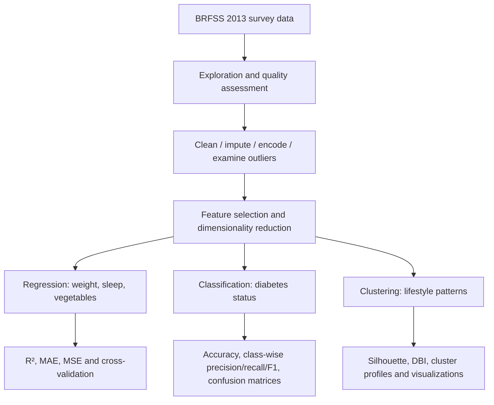

# Behavioral Health Analytics with Machine Learning

**A comparative study of regression, classification, and unsupervised learning on the 2013 Behavioral Risk Factor Surveillance System (BRFSS).**

`Python` · `scikit-learn` · `XGBoost` · `PCA` · `UMAP` · `K-Means` · `Healthcare Analytics`

## Overview

How much can lifestyle and survey data reveal about health-related outcomes? This project investigates that question using a large, heterogeneous US public-health survey. Rather than focusing on a single predictive model, we built an experimental workflow spanning **continuous-outcome prediction**, **three-class diabetes-status classification**, and **unsupervised behavioral segmentation**.

The project addresses practical challenges of real-world tabular data: missing values, mixed variable types, redundant attributes, high dimensionality, and severe class imbalance. We evaluate when straightforward models suffice, when ensembles help, and when the data contain little useful predictive signal.

## Results at a glance

| Experiment | Reported result | Interpretation |
|---|---:|---|
| Weight regression (linear model) | Test R² ≈ **0.71** | Strongest of the three regression targets |
| Vegetable-consumption regression | Test R² ≈ **0.63** | Moderate predictive relationship |
| Diabetes classification (decision tree) | Accuracy **98.13%** | High overall accuracy, but weaker precision for the minority at-risk class |
| K-Means after UMAP | Silhouette ≈ **0.52** | Moderate cluster separation in a 2D embedding |

## Research questions

1. Which lifestyle-related survey outcomes can be predicted from the available attributes?
2. Can supervised models distinguish non-diabetic, at-risk, and diabetic respondents?
3. How do imbalance-aware and ensemble methods change minority-class recognition?
4. Can unsupervised methods reveal interpretable behavioral profiles without outcome labels?
5. What are the limitations of PCA, UMAP, and feature selection on a large noisy dataset?

## Dataset

**Source:** Behavioral Risk Factor Surveillance System (BRFSS), 2013; the project used a Kaggle-hosted version (see references in the original report). BRFSS surveys non-institutionalized US adults aged 18 and older about health conditions and behaviors.

- Raw dataset: approximately **500,000 records** and **300 variables**, according to the report.
- Analysis after preprocessing: the clustering notebook reports **491,775 rows**.
- Mixed numerical and coded categorical variables, including activity, diet, sleep, weight and diabetes-status indicators.
- Outcomes investigated: `weight2` (weight), `sleptim1` (sleep), `X_vegesum` (vegetable consumption), and `diabete3` (diabetes-status classification).

**Data availability:** The raw survey data are not bundled. Obtain the corresponding BRFSS 2013 dataset from its authorized source and check its terms, schema and column names before running the notebook. Do not assume other BRFSS releases are interchangeable.

## System workflow

### Data preparation

The notebook explores data types and missingness, removes selected irrelevant and redundant columns and duplicates, fills numerical missing values using medians and categorical values using modes, and applies category-dependent encoding (label, ordinal, one-hot, and custom mappings). It also explores outliers and correlations. **SelectKBest** was explored for feature selection, followed by **PCA** for dimensionality reduction. For clustering, **StandardScaler** and **UMAP** were also explored.

**Important methodological caveat:** The original exploratory notebook performs some transformations on the full dataset before model splitting. This may introduce data leakage. A more rigorous follow-up would fit imputers, encoders, scalers, feature selectors and PCA **on training folds only** through `Pipeline`/`ColumnTransformer`.

## Experiment A — Regression

We trained linear regression models for three distinct continuous targets and evaluated using R², MSE, MAE and K-fold cross-validation. The experiment reveals that predictability is **target-dependent**: weight and vegetable-consumption targets showed substantial explanatory power, whereas sleep-duration prediction remained weak. An additional **Gradient Boosting Regressor** experiment on sleep did not materially resolve the problem (reported R² around 0.04).

| Target | Test R² | MSE | MAE |
|---|---:|---:|---:|
| `weight2` | 0.71 | 404.23 | 14.48 |
| `X_vegesum` | 0.63 | 2,779 | 34 |
| `sleptim1` | −0.004 | 1.65 | 0.99 |

R² is a regression metric, **not classification accuracy**. Negative R² indicates worse prediction than a constant-mean baseline on that evaluation set. Units and encoding of the original survey targets should be checked before interpreting MAE clinically.

## Experiment B — Diabetes-status classification

The classification target was mapped into three categories: **non-diabetic**, **at-risk**, and **diabetic**. The main baseline was a **Decision Tree** with maximum depth 7, evaluated on a stratified train/test split.

The report records **98.13% accuracy**. Class-level findings matter more than accuracy alone:

| Class | Reported precision | Reported recall | Reported F1 |
|---|---:|---:|---:|
| Non-diabetic | 0.99 | 0.99 | 0.99 |
| At-risk | 0.68 | 0.87 | 0.76 |
| Diabetic | 0.99 | 0.94 | 0.96 |

The **at-risk class** is substantially smaller and harder to distinguish. We also explored **K-nearest neighbors**, **Random Forest**, and **XGBoost**. The Random Forest experiment explicitly tested `class_weight='balanced'`; the report describes at-risk recall improving from near zero to approximately 0.95 under that configuration. This illustrates why minority-class recall and precision must be reported alongside overall accuracy.

**Evaluation caution:** The report and notebook include experiments with different model configurations and potentially different evaluation subsets. Do not rank all models solely from headline accuracy without verifying identical held-out data and leakage-free preprocessing.

## Experiment C — Unsupervised behavioral segmentation

We explored whether unlabeled survey responses contain meaningful structure:

1. Scale features and compare **PCA** with nonlinear **UMAP** representations.
2. Explore cluster count using the **elbow method** and separation using the **silhouette score**.
3. Fit **K-Means** and interpret cluster profiles using feature averages.
4. Explore **hierarchical clustering** for finer behavioral groupings and **DBSCAN** for density-based clustering/noise detection.

The report describes an improvement in silhouette from roughly **0.39 (PCA-based representation)** to **0.52 (UMAP-based representation)**. It also discusses healthy, moderate, and unhealthy lifestyle profiles and a hierarchical subgroup associated with anxiety/sleep issues.

**Interpretation caution:** The report contains inconsistent descriptions of whether the selected K-Means solution has two or three clusters; the notebook explicitly fits `KMeans(n_clusters=3)`. Cluster names are *post-hoc exploratory descriptions*, not validated medical categories. Embedding-space silhouette scores are not proof that the original high-dimensional groups are clinically meaningful.

## Engineering and technical decisions

| Decision | Motivation | Trade-off |
|---|---|---|
| Median/mode imputation | Retain observations with missing values | Can distort distributions and should be fitted per training fold |
| Multiple categorical encoders | Respect different variable semantics | Requires careful category documentation |
| PCA / SelectKBest | Reduce high dimensionality | PCA components reduce original-feature interpretability |
| Stratified split | Preserve minority-class proportions | Does not by itself solve class imbalance |
| Balanced Random Forest | Increase attention to underrepresented labels | Precision/recall trade-off must be measured |
| UMAP for clustering exploration | Capture nonlinear local structure | Sensitive to parameters; 2D visual separation can be misleading |
| Multiple model families | Compare assumptions and failure modes | Comparisons require a common evaluation protocol |

## Tech stack

- **Python / Jupyter Notebook:** exploratory experiments and visual outputs.
- **pandas / NumPy:** tabular manipulation and numerical analysis.
- **scikit-learn:** preprocessing, PCA, model training, metrics and cross-validation.
- **XGBoost:** gradient-boosted tree classification.
- **UMAP (`umap-learn`):** nonlinear dimension reduction.
- **Matplotlib / Seaborn:** distributions, performance charts and cluster plots.

## Limitations and next steps

- **Prevent leakage:** split before imputation, encoding, scaling, PCA and feature selection; use nested CV where tuning is involved.
- **Audit target leakage:** exclude survey features that encode the outcome directly or indirectly; verify diabetes-status recoding.
- **Improve evaluation fairness:** same train/test indices, class distributions and metrics across classifiers; add macro-F1 and per-class PR curves.
- **Validate clustering:** resolve K=2 versus K=3, check stability across random seeds, and compare cluster profiles in original feature units.
- **Strengthen reproducibility:** pin tested dependencies, publish a data dictionary and config, and add smoke tests and a small sample workflow.
- **Study generalization:** evaluate other BRFSS years or populations while accounting for changing survey coding and domain shift.

## References

- [CDC — Behavioral Risk Factor Surveillance System](https://www.cdc.gov/brfss/)
- [scikit-learn documentation](https://scikit-learn.org/stable/)
- [UMAP documentation](https://umap-learn.readthedocs.io/)
- [XGBoost documentation](https://xgboost.readthedocs.io/)

